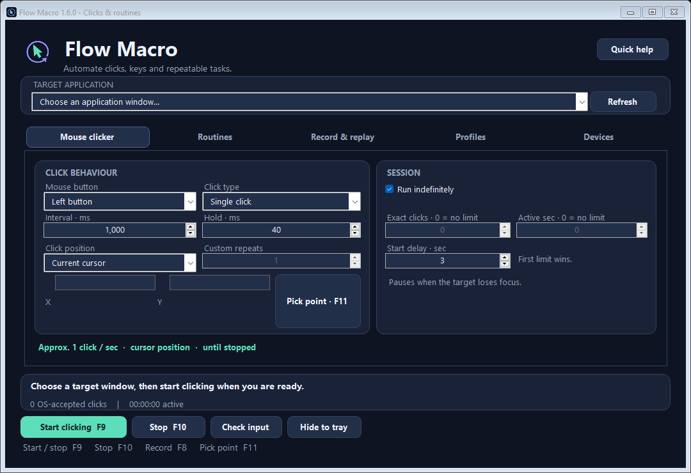
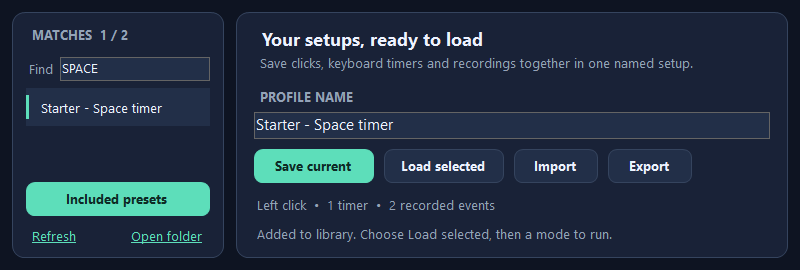

# Flow Macro

A general-purpose Windows mouse clicker, keyboard timer and macro recorder, with an Android tap-runner preview. Build repeatable tasks in a navy and mint workspace with separate pages for clicking, routines, recordings, profiles and device transfers.

[Download the latest release](https://github.com/William-osei/flow-macro/releases/latest) · [Android guide](android/README.md) · [Changelog](CHANGELOG.md) · [Contributing](CONTRIBUTING.md)



The current Windows release is **1.6.0**. Android **1.6.0** is a test build. Existing `FarmMacro.exe` launchers, local settings and tap-only profile files stay compatible.

- Left, right and middle clicking, bursts, exact click totals and infinite sessions.
- Independent keyboard and mouse timers, including cooldown timing across focus pauses.
- Ordered recordings with key holds, chords and click positions.
- Searchable named profiles, portable JSON import/export and a browser for general starter presets.
- Android floating controls for adding tap points, straight swipes and removing the last action.
- Focus pausing, an emergency stop, tray controls and a local input test pad.

## Start

1. Download the Windows ZIP from [Releases](https://github.com/William-osei/flow-macro/releases/latest) and extract the whole archive, including its `presets` folder.
2. Open **FarmMacro.exe** or **Start Farm Macro.cmd**.
3. Choose the application window you want to control and configure a mode below.
4. Start the task, then focus that window during the countdown. Use **F10** to stop.

A new session does not automatically choose a game or another app. Launching, importing and loading profiles always leaves playback stopped.

| Page | Use it for |
| --- | --- |
| Mouse clicker | One mouse task with an optional exact click-count limit |
| Routines | Several keys or click points with independent timers |
| Record & replay | An ordered sequence of keyboard holds and mouse clicks |
| Profiles | Named setups for all three modes and portable JSON files |
| Devices | Timer drafts for the Android tap runner |

## Mouse clicker

Choose left, right or middle click; set the interval and press duration; then choose single clicks, a double-click burst or a custom burst. The rate preview includes the time required to release each click.

Use the current pointer position or a fixed point inside the target. **F11** captures a point while stopped; use the exact shortcut shown if Windows reserves that key. Coordinates are relative to the target's client area. Recheck points after resizing or changing its layout.

Use an exact **total click limit**, an active-time limit, or **Run indefinitely**. The total counts individual clicks, including clicks in a burst; the final burst can be partial. Counted completion lets the last held button release normally. Stop/F10 releases held inputs immediately.

Focus the target during the countdown. **F9** starts or stops the session; **F10** is the emergency stop. A new Start resets session timing. The app shows Ctrl+Alt alternatives when another program reserves a shortcut.

## Routines and recordings

Add a key or mouse click, then edit its interval, hold, burst and first-delay values. Separate click rows can use different points. Each enabled row has its own timer. Use Record & replay when order matters.

The **Keep CD** checkbox preserves a single-press row's next allowed time across focus and modifier pauses. Its first cast uses the initial delay; subsequent casts wait the full interval from the last accepted press. A long pause produces one due press instead of catching up missed cycles. Explicit Stop/Start creates a fresh session. This schedules input and does not read the target app's actual cooldown display.

Supported inputs include letters, digits, navigation/editing keys, F1–F7 and F12, and the number pad. F8–F11 remain reserved for macro controls. Number-pad behavior follows Windows' Num Lock state; the app does not change it.

Included examples are general-purpose. Your own imported routines stay in your local library. Personal profiles are excluded from public downloads and source tracking.

Start Record/F8 explicitly, focus the target and perform your actions. Finish with F8, then review events and delays before playing. Keys, chords, holds and click positions are recorded. Continuous camera or pointer movement is not recorded.

The recorder starts empty on a new installation. Add keys/clicks or choose a single-click, double-click or Space example. Clear and example replacement ask before discarding current events. Saved recordings load stopped.

Keep each input down balanced by an up event. Choose infinite replay, a loop count or an active-time limit. A focus pause releases held inputs and restarts the current pass.

## Profiles

**Profiles → Save current** stores the clicker, timer rows and recording together. Loading never starts a macro. Older profiles receive default clicker settings while keeping their original timers and recordings.

Use **Profiles → Included presets** to browse the general examples shipped beside the app. Choose a preset and **Add to library**, then select it in the saved list and choose **Load selected**. Pick **Mouse clicker**, **Routines** or **Record & replay** before starting. **Find** filters saved names; Escape clears the filter. Searching never loads or starts a routine.

The preset browser's **Open folder** button opens the portable `presets` folder. The saved-library **Open folder** link opens this Windows user's saved profile directory. Bundled files do not appear in the saved library until you add or import them.



Portable JSON imports receive a new name if needed and stay in the library for review. Importing does not start playback. Page-level Save/Load controls remain available for the most recent timer or recording setup.

Settings stay under `%LOCALAPPDATA%\FarmMacro`. The Windows app needs no account or network connection.

## Input checks and focus

**Check input** tests any supported key or mouse button once or twice with a configurable hold and countdown. Select the local input test pad for a contained delivery check. Counters show inputs accepted by Windows; check the receiving app to see what it did.

Input pauses automatically when the selected window loses focus. This focus pause differs from stopping a session with F9 or F10. Switching desktops or hiding the macro in the tray does not enable background input. Stop before an in-app text field, chat or menu: foreground protection cannot distinguish them from the rest of the same app.

Flow Macro repeats the inputs and timings you configure; it does not read cooldowns or adapt to changing controls. Acceptance depends on the target app.

F10 remains available when hidden. Double-click the tray icon to restore the window. A second launch restores the existing copy rather than creating another macro engine.

## Windows permissions

If the target runs as administrator, the macro needs matching privileges. Close it completely, then use **Start Farm Macro as Administrator.cmd**, or right-click **FarmMacro.exe → Run as administrator** and review Windows' prompt yourself. Running the target normally is another option.

Higher or unknown target privileges block starting with a readable explanation. The app never elevates itself or changes security policy. [Microsoft documents the Windows input restriction](https://learn.microsoft.com/en-us/windows/win32/api/winuser/nf-winuser-sendinput).

## Android

The Android preview uses mapped on-screen taps and straight swipes. Fresh setups begin with one general Tap 1 action and the local tap test pad. From the floating controls, add a tap or swipe, map its point or endpoints, and remove the last action while stopped. Every action has its own timing. Choose another target and map its controls before starting. Existing tap-only profiles remain compatible.

**Devices → Export Android draft** transfers timer settings as unmapped taps. Imports clear all points for fresh mapping and never start playback. Android requires manually enabled accessibility access. Stop prevents subsequent gestures; a gesture already dispatched can finish within one second. Profiles containing swipes use mobile format version 2, which older Android builds reject.

Download `FlowMacro-Android.apk` from [Releases](https://github.com/William-osei/flow-macro/releases/latest) and see [the Android guide](android/README.md). The Android preview has automated gesture/profile/scheduler checks; physical-device layouts and target-app acceptance remain untested. macOS, Linux and iOS builds are not included.

## Future Play Store release

The app is free in this development release, with no billing, ads or paid unlocks. The [publishing and income plan](docs/PLAY_STORE_PLAN.md) covers Google Play requirements and a possible one-time Pro upgrade after phone testing. Store submission, account verification, AAB signing and real purchases are future work. See the [privacy policy](PRIVACY.md).

## Build and check

```powershell
.\build.ps1
.\test.ps1
$preview = Start-Process .\FarmMacro.exe -ArgumentList '--preview', 'build/previews' -Wait -PassThru
if ($preview.ExitCode -ne 0) { throw 'Preview checks failed.' }
```

The Windows app builds with the .NET Framework compiler included on Windows, without NuGet packages. Previews send no input and register no hotkeys. To build a separate executable while another copy is open, use `./build.ps1 -OutputPath ./build/FarmMacro.next.exe`.

For a full Android APK, run `./scripts/PrepareAndroidTools.ps1`, then `./scripts/BuildAndroid.ps1` on Windows. This downloads project-local Android SDK/OpenJDK tools and creates a local development signing key. See the [Android build guide](android/README.md#build-on-windows). After building both platforms, `./scripts/PackageWindows.ps1` creates the Windows ZIP and checksum in `dist`.

Git contains source, icons, documentation and general starter presets. The release script uses `presets/catalog.txt` to select its public examples. `personal-presets/` is ignored and never packaged. Generated executables, APKs, ZIPs, SDK caches and signing keys stay out of the repository; downloadable binaries live in GitHub Releases. CI checks Windows tests and interface previews, plus Android's gesture/profile/scheduler tests.

Icon source: `assets/farm-macro.svg`; regenerate its nine sizes with `scripts/BuildBrand.ps1`. Development and verification details are in [CONTRIBUTING.md](CONTRIBUTING.md).
